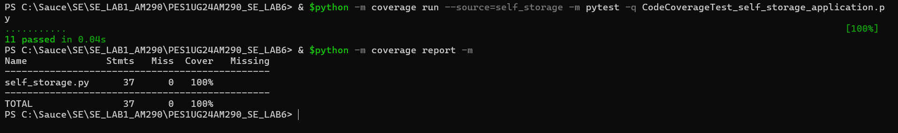
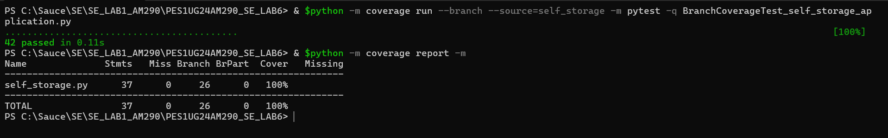

# Lab 6: Code and Branch Coverage

**Student:** Suhas Mohan Kumar  
**SRN:** PES1UG24AM290

Source: https://github.com/SETAPESU26/L6_L7_51_self_storage/tree/main/Lab%206

The application is copied unchanged from the assigned repository. The original
two tests are preserved in `test_self_storage_starter.py`.

## Results

| Suite | Tests passed | Statements covered | Branch outcomes covered |
| --- | ---: | ---: | ---: |
| Starter | 2 | 14/37 (37.84%) | 6/26 (23.08%) |
| Code coverage | 11 | 37/37 (100%) | Not measured in line-only run |
| Branch coverage | 42 | 37/37 (100%) | 26/26 (100%) |

The starter branch-mode report displays 32% combined coverage: 20 covered
statement/branch opportunities out of 63. This differs from branch-only coverage.

## Reproduce

Run from this folder with Python 3.11 or newer:

```sh
python -m pip install -r requirements.txt
python -m coverage run --source=self_storage -m pytest -q test_self_storage_starter.py
python -m coverage report -m
python -m coverage run --source=self_storage -m pytest -q CodeCoverageTest_self_storage_application.py
python -m coverage report -m
python -m coverage run --branch --source=self_storage -m pytest -q BranchCoverageTest_self_storage_application.py
python -m coverage report -m
```

Tests are named to match the handout, so pass their filenames explicitly to pytest.
Coverage measures only `self_storage.py`, excluding test code from the denominator.

## Analysis

Line coverage checks whether executable statements ran. Branch coverage also
checks both outcomes of decisions. Neither proves all possible paths or inputs
are correct. The line suite executes each statement, including both validation
errors, but does not exercise every decision outcome.

The branch suite checks all unit sizes; membership with small/medium and large
units; zero, negative and deposit-boundary months; ordinary and climate rates;
exactly six versus seven extra months; owner visitor limits of four/five;
guest hours five/six and twenty-two/twenty-three; guest visitor limits two/three;
and every autopay/prior-late combination at the current/grace/lien boundaries.
Each test asserts the expected result or exception rather than merely executing code.

The compound boolean conditions also receive short-circuit boundary inputs.
Coverage.py's branch metric does not separately measure every boolean operand
or demonstrate exhaustive path coverage.

## Evidence

`results/code_coverage.png` and `results/branch_coverage.png` are terminal screenshots
captured by the student, showing 11 and 42 passing tests respectively and 100%
coverage. The branch screenshot also shows all 26 branch outcomes covered.
The `.txt` transcripts, HTML views and coverage JSON reports record the earlier
verification runs; test timings may differ. Only the final 100% results have screenshots.

### Code coverage terminal screenshot



### Branch coverage terminal screenshot



Two commits separate the code-coverage submission from the branch-coverage submission.
Tests and documentation were prepared with AI assistance; review and understand
the boundary cases before the lab demonstration.
